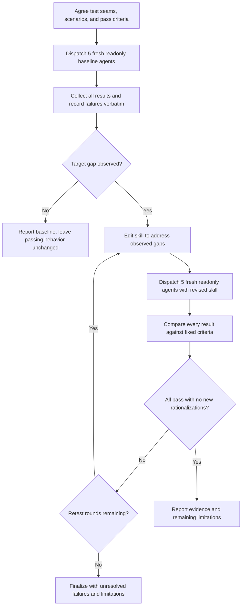

Create or update a skill, or answer a question about it, based on these requirements:

```
${input:requirements:Describe the skill or capability to create}
```

## Arguments and required skills

Parse optional flags from the invocation arguments; treat the remaining text as the requirements.

- `--tests`: opt in to testing. When omitted, do not run tests or load the two testing skills listed below.
- `--question`: answer the question without creating or modifying files. Read the applicable skills before answering. This mode takes precedence over implementation and test execution, including when combined with `--tests`.

For every invocation, YOU MUST read and follow:

- **REQUIRED:** `int-writing-skills`
- **REQUIRED:** `int-writing-for-agents`

### Testing (only with `--tests`)

Only when `--tests` is present, YOU MUST also read and follow:

- **REQUIRED:** `int-test-driven-development-advanced`
- **REQUIRED:** `int-verification-before-completion`

Without `--tests`, apply the writing guidance without its testing workflow or testing-skill dependencies; report that tests were not run. With `--question`, read the applicable skills and answer without executing this workflow.

For `--tests` without `--question`, use only read-only agents for every dispatch. The authoring agent alone edits the skill. Limit testing to three rounds total: one baseline and at most two retest rounds, with five fresh agents per round (15 agents maximum). Follow this bounded cycle:



1. **Define coverage.** Confirm the test seams with the user, then freeze scenario prompts and observable pass criteria covering the requested behavior. Use the scenario and micro-test requirements in `int-writing-skills`.
2. **Baseline before edits.** Dispatch exactly five independent read-only agents with fresh contexts. Each runs the full scenario set using the current skill for an update, or without the proposed skill for a new skill. Give every agent the same bounded task: evaluate the scenarios within read-only permissions, return concrete decisions and rationalizations verbatim, and leave workspace files unchanged. For scenarios requiring writes, describe the intended actions rather than executing them; report this execution limitation. Collect all five results before editing. If no target gap appears, report that evidence rather than inventing a failure.
3. **Edit.** Address the observed gaps in the target skill only. Preserve the frozen prompts and pass criteria so results remain comparable.
4. **Retest.** Dispatch five new read-only agents, not follow-ups to earlier agents, with the revised skill and the same scenarios and criteria. Inspect every result for the required behavior and new rationalizations; agent success claims alone are insufficient evidence.
5. **Repeat or finalize.** If any agent fails and a retest round remains, revise the skill and rerun all five fresh read-only agents. Count every dispatched batch, including incomplete batches, toward the three-round limit. Stop early when all five pass every applicable criterion without new rationalizations; otherwise finalize after the second retest with unresolved failures explicitly reported. Make no further edits or refactors after the last retest, so the delivered revision matches the last tested revision. Report baseline failures, results for each round, rounds used, and blocked or unverified requirements. Unavailable agents, incomplete runs, and reaching the cap with failures are limitations, not passes; further rounds require explicit user authorization.

## Response or implementation

If `--question` is present, answer using the loaded guidance and stop without implementing changes or running tests.

Otherwise, create or update the skill in `.github/skills/<skill-name>/SKILL.md`, following the repository's conventions and the requested scope. Complete the task rather than returning only a plan. Do not modify unrelated files. Finish with a concise summary of the skill changes and any verification performed, including blockers or unverified requirements.
