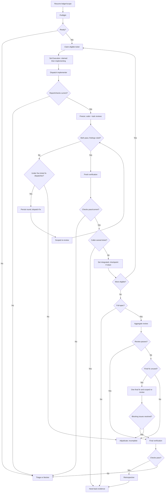

# Subagent-Driven Development

Controller for assigned tickets or dependency graphs; the brief governs. The controller owns dispatch, state, review, integration, and hand-back. Use the [implementer](implementer-prompt.md), [code-review](code-reviewer-prompt.md), [task-review](task-reviewer-prompt.md), and [re-review](re-review-prompt.md) templates.

**Required skills:** `int-test-driven-development`, `int-verification-before-completion`, and `int-retrospective` for standalone full-spec delivery.

## Operating rules

- Use the existing checkout; preserve user changes. Dispatch sequentially, coordinate shared-file ownership, and freeze edits during review.
- The controller alone changes execution states and decides acceptance. Workers edit only assigned files and preserve report history.
- On resume, restore the ledger, snapshot, dependencies, checks, findings, rulings, and round counters. Resume at that gate; never reset budgets.

## Controller flow



Preflight: read tickets/comments, spec, instructions, glossary, and ADRs; map criteria to observable outcomes and confirm seams; ensure the graph is acyclic and dependencies integrated; preserve checkout; confirm baseline, permissions, tracker, and dated `.scratch` reports. For example:

```sh
just sdd::workspace --workspace /absolute/checkout \
  --reports-dir .scratch/YYYY-MM-DD-feature/reports --ticket 03
```

The controller may review small diffs directly. Worker templates govern tests, review, evidence, and reports. Missing or stale checks block acceptance. Integrate only when current verification and review match the snapshot. Cap corrective dispatches at five per ticket across reviews; persist each round and never dispatch round six. Full-spec delivery allows one final-fix dispatch and scoped re-review.

Controller checkpoints between tickets are authorized when useful and changes isolate cleanly. Stage accepted changes only; preserve caller edits and report deferrals. Workers follow assigned commit permissions.

## Hand-back

Hand back snapshot, evidence mapping, verdicts/rulings, check results, report paths, ticket states, retrospective, and limitations. Keep blockers explicit; do not publish, close tickets, or delete user work without authorization.
