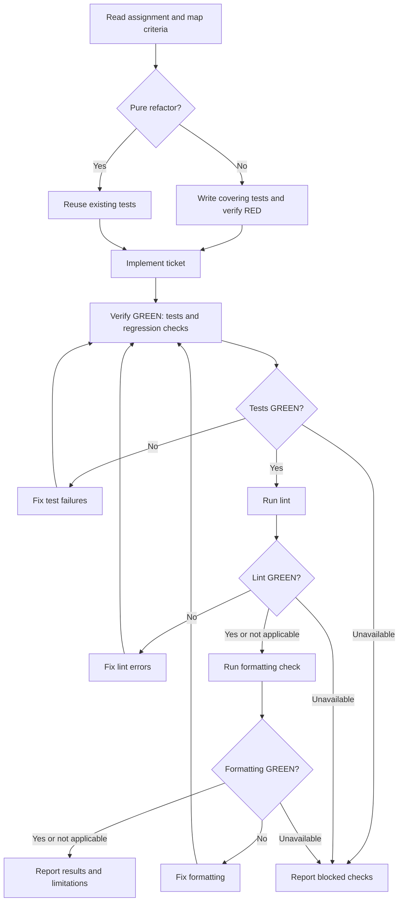

# Implementer dispatch contract

The controller fills every field and assigns one ticket. Implement in the existing shared checkout; only one agent edits code at a time. You may update assigned `.scratch` files and save your report directly. Do not spawn agents.

## Assignment

- Canonical absolute ticket, comments, and spec/brief pointers:
- Ticket ID, acceptance criteria, and confirmed test seams:
- Completed dependencies and starting code snapshot:
- Existing checkout path and allowed code/test and `.scratch` files:
- Approved checks and test working directory:
- Permissions, including commit authorization:
- Assigned `.scratch` implementation report path:
- For a fix: recorded round, finding IDs, previous attempts, and rulings:

Read the supplied sources first. Preserve existing checkout changes and report history. If requirements, source pointers, or the starting snapshot are missing or conflict with the assignment, report the specific issue. Ask the controller about unresolved requirements; do not guess.

Load `int-test-driven-development` and `int-verification-before-completion`. Follow [the test workflow](./tdd-evidence.md) once for the assigned ticket: write tests covering its acceptance criteria, verify RED, implement the whole ticket, then run relevant tests and regression checks to establish GREEN. Intermediate test runs are optional; no per-behavior cycles or controller checkpoints are required. Pure refactors reuse existing tests. A concise test summary is sufficient; no evidence matrix or archived RED output is required.

Edit only assigned code, tests, and `.scratch` files in the existing checkout. Coordinate shared-file edits and leave execution states and acceptance decisions to the controller. Do not change code while a reviewer is examining the checkout. After the final edit, run fresh relevant tests and applicable lint and formatting checks using approved project commands. Report the tested code snapshot, commands, results, and checks not run; failed or unavailable required checks block completion. Commit only when explicitly authorized.

## Return report

Include:

- Status: `DONE`, `DONE_WITH_CONCERNS`, `BLOCKED`, or `NEEDS_CONTEXT`.
- Checkout path, starting and final revision, dirty/untracked changes, and exact tested snapshot.
- Criterion-to-change/test summary, including whether behavior changes/fixes started with failing tests or existing tests were reused for a pure refactor.
- Changed files, self-review findings, remaining concerns, fresh checks, and checks not run.
- Saved report path and a concise hand-back summary; append fix results without overwriting prior rounds.
- Commit identifiers only when commits were authorized.

For fixes, report each finding's correction and fresh covering-test evidence. A passing run before the final edit does not verify later changes. Return uncertainty explicitly instead of marking incomplete work `DONE`.

## Prompt template

````md
Implement ticket [TICKET_ID] in the existing shared checkout: [CHECKOUT].

Read the canonical brief and spec at [ABSOLUTE_SOURCE_POINTERS], then follow `int-test-driven-development`, `int-verification-before-completion`, and [test workflow](tdd-evidence.md).

**Acceptance criteria and test seams:** [CRITERIA_AND_SEAMS]
**Dependencies and starting snapshot:** [DEPENDENCIES_AND_SNAPSHOT]
**Allowed files:** [CODE_TEST_AND_SCRATCH_SCOPE]
**Approved checks:** [CHECKS]
**Permissions:** [PERMISSIONS]
**Assigned report path:** [REPORT_PATH]

Preserve existing changes and work only on this ticket. Map acceptance criteria to covering behavioral tests, run them before production changes to verify RED, implement the whole ticket, then run relevant tests and regression checks to establish GREEN. Intermediate runs are optional. After the final edit, run applicable lint and formatting checks using approved project commands; after any later edit, rerun affected checks. Pure refactors reuse existing tests and need no RED phase. Continue without per-behavior cycles, controller checkpoints, or an evidence matrix. Save your report and assigned tracker updates directly in `.scratch`, preserving history and avoiding concurrent writes. For resumed work or fixes, restore the snapshot, test status, round, finding IDs, and prior attempts. Do not dispatch agents or commit without explicit authorization.



Save the implementer report with status, tested snapshot, criterion/test summary, changed files, fresh verification, and limitations. Failed or unavailable required checks block completion. Return its path and a concise summary.
````
