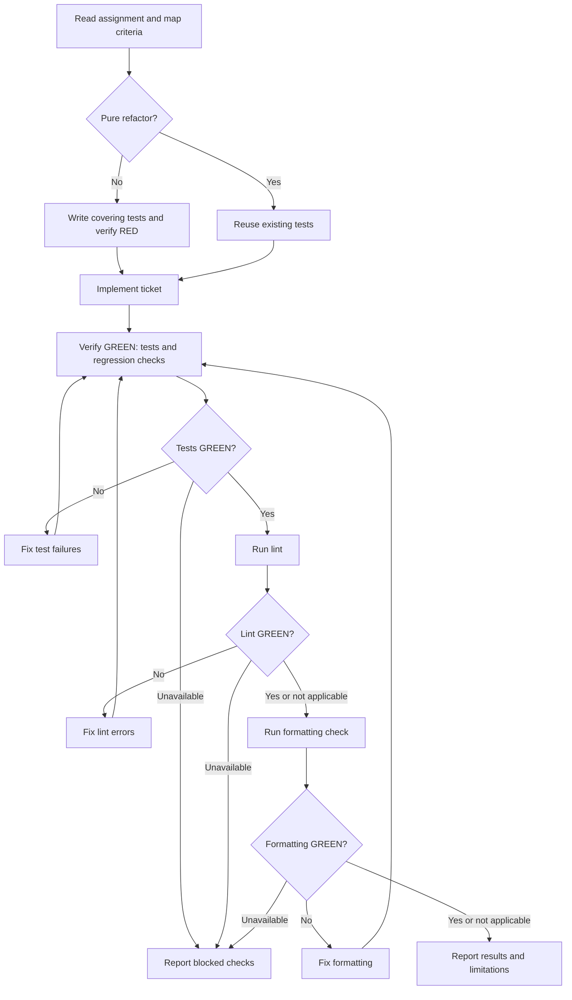

# Implementer dispatch prompt

Use the complete template below for one ticket. Fill every field and dispatch against the existing shared checkout, with only one agent editing code at a time. Implementers do not dispatch agents.

## Prompt template

````md
Implement ticket [TICKET_ID] in the existing shared checkout: [CHECKOUT].

Read the canonical ticket, comments, and spec/brief at [ABSOLUTE_SOURCE_POINTERS], then follow the `int-test-driven-development` skill, `int-verification-before-completion` skill.

**Acceptance criteria and confirmed test seams:** [CRITERIA_AND_SEAMS]
**Completed dependencies and starting snapshot:** [DEPENDENCIES_AND_SNAPSHOT]
**Allowed code, test, and `.scratch` files:** [FILE_SCOPE]
**Approved project checks and test working directory:** [CHECKS_AND_DIRECTORY]
**Permissions, including commit authorization:** [PERMISSIONS]
**Assigned `.scratch` report path:** [REPORT_PATH]
**For a fix:** [ROUND, FINDING_IDS, PRIOR_ATTEMPTS, AND RULINGS OR NONE]

Read the supplied sources first. Preserve existing checkout changes and report history. If requirements, source pointers, or the starting snapshot are missing or conflict with this assignment, report the specific issue and ask the controller; do not guess.

Edit only assigned code, tests, and `.scratch` files. Coordinate shared-file edits, leave execution states and acceptance decisions to the controller, and pause code changes while a reviewer examines the checkout. Update only assigned `.scratch` files and append fix results without overwriting prior rounds. For resumed work or fixes, restore the snapshot, test status, round, finding IDs, prior attempts, and rulings. Commit only when explicitly authorized.

Follow the flowchart once for this ticket:



Save the report at [REPORT_PATH] with:

- Status: `DONE`, `DONE_WITH_CONCERNS`, `BLOCKED`, or `NEEDS_CONTEXT`.
- Checkout path, starting and final revision, dirty/untracked changes, and exact tested snapshot.
- Criterion-to-change/test summary, including whether behavior changes started with failing tests or a pure refactor reused existing tests.
- Changed files, self-review findings, remaining concerns, fresh check commands and results, and checks not run.
- For fixes, each finding's correction and fresh covering-test evidence.
- A concise hand-back summary; include commit identifiers only when authorized.

Update only assigned tracker files in `.scratch`, preserving history. Failed or unavailable required checks block completion. Return the report path and concise summary.
````
